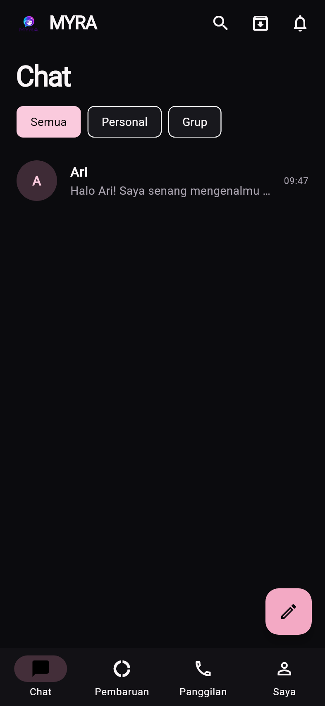
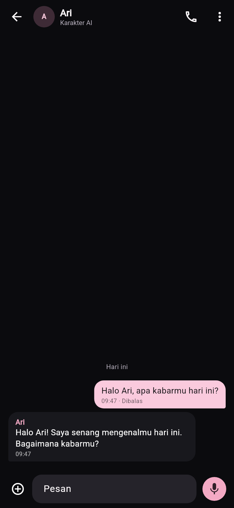

# MYRA Mobile

Messenger Android MYRA, dibuat dengan Flutter dan Dart. Logo, baby pink, dan latar hitam mengikuti studio web. Akun, karakter, grup, universe, pesan, media, dan memori dibaca dari proyek Supabase yang sama. Dashboard dan skema backend dikelola di [myra_web](https://github.com/Vhirazhr/myra_web).

<p>
  
  
</p>

Tampilan dari alur yang dijalankan dengan akun uji dan model lokal.

## Pasang dan masuk

1. Unduh **MYRA-0.1.0-arm64.apk** di [GitHub Releases](https://github.com/Vhirazhr/myra_mobile/releases). Buka file di ponsel Android 7.0 atau lebih baru dengan prosesor ARM64. Izinkan pemasangan dari aplikasi yang membuka APK jika Android memintanya.
2. Saat pertama dibuka, masukkan **publishable key** proyek `myra` dari Supabase Dashboard → **Connect** atau **Settings → API Keys**. Alamat proyek sudah terisi di aplikasi.
3. Masuk dengan email dan kata sandi akun yang sudah memiliki akses ke studio web MYRA. Konfirmasi usia pada penggunaan pertama. Ketuk ikon pensil pada tab **Chat** untuk memilih atau membuat karakter.
4. Untuk memperbarui APK di atas instalasi lama, gunakan build dengan application ID dan sertifikat yang sama serta version code yang lebih tinggi. Prarilis ini menggunakan sertifikat pengujian. Simpan keystore milik proyek untuk distribusi produksi.

## Alur aplikasi

- **Chat** menampilkan percakapan personal dan grup. Tekan lama satu chat untuk mengarsipkan atau menyematkannya. Di dalam chat, tekan lama pesan untuk membalas, memberi reaksi, mengedit pesan sendiri, atau menghapusnya. Menu percakapan menyediakan pencarian, latar chat, bahasa, mode, tahap hubungan, dan opt-in sapaan proaktif.
- Ikon **+** di kolom pesan membuka lampiran, mention anggota grup, dan pilihan memori per pesan. Tombol mikrofon merekam pesan suara. Tekan berhenti untuk meninjau nama lampiran, lalu kirim. Pesan tersimpan lebih dahulu. Jika AI gagal, **Coba lagi** menggunakan ID pesan yang sama.
- **Pembaruan** menampilkan status 24 jam sesuai audiens. Pilih karakter, tambahkan teks, foto atau video, lalu bagikan. Tampilan, suka, reaksi, dan balasan disimpan di Supabase.
- **Panggilan** menggunakan token sementara dari Edge Function dan Gemini Live untuk audio dua arah. Status terhubung diperbarui setelah konfirmasi protokol. Riwayat juga mencakup panggilan dari web.
- **Saya** memuat memori, universe dan crossover, kotak notifikasi, jam tenang, dan preferensi push. Di profil karakter, **Kehidupan karakter** menampilkan diari, peristiwa, dan riwayat hubungan dari simulasi web.

## Konfigurasi bersama

Kontrak yang dipakai mengikuti [backend web pada commit c3cecea](https://github.com/Vhirazhr/myra_web/tree/c3ceceacd308aca74288a2b319aa0f2a13e50efa/supabase). Untuk proyek Supabase yang baru dibuat, terapkan migrasi serta deploy fungsi `myra` dan `worker`, kemudian daftarkan akun pemilik pada `admin_access`. Langkah cloud tersedia di [panduan web](https://github.com/Vhirazhr/myra_web#sambungkan-proyek-supabase-myra).

| Fitur | Konfigurasi |
| --- | --- |
| Login, media dan realtime | Supabase Auth, RLS, bucket privat dan publication dari migrasi web. Tambahkan `id.myra.mobile://auth/recover` pada daftar redirect yang diizinkan untuk pemulihan email. |
| AI dan memori | Pilih provider dan model di studio web. Simpan API key provider di Supabase Edge Function Secrets. Worker memproses antrean memori dan aktivitas terjadwal. |
| Voice note AI, transkripsi dan Live | Konfigurasi `GEMINI_API_KEY` serta model suara/Live yang didukung akun di server. Ponsel memerlukan izin mikrofon. |
| Push Android | Daftarkan `id.myra.myra_mobile` di Firebase, letakkan konfigurasi client di `android/app/google-services.json`, lalu build ulang. Simpan `FIREBASE_SERVICE_ACCOUNT_JSON` di secret worker, aktifkan jadwal, dan izinkan notifikasi dari tab Saya. APK prarilis ini dibuat tanpa konfigurasi Firebase pemilik. |

## Build dari source

Gunakan Flutter 3.35.7, Dart 3.9.2, JDK 17, Android SDK 36, Build Tools 35, NDK 27.0.12077973 dan CMake 3.22.1. Gradle Wrapper tersedia di repo. Untuk bundel konfigurasi publik saat build, salin `config.example.json` menjadi `config.local.json` dan isi publishable key proyek.

```sh
flutter pub get
flutter analyze
flutter test
flutter build apk --release --split-per-abi --target-platform android-arm64 --dart-define-from-file=config.local.json
```

APK berada di `build/app/outputs/flutter-apk/app-arm64-v8a-release.apk`. Untuk memasukkan key melalui layar pertama, hilangkan opsi `--dart-define-from-file`. Untuk menandatangani dengan keystore distribusi, sediakan `android/key.properties` dengan `storeFile` (absolut atau relatif ke `android/app`), `storePassword`, `keyAlias`, dan `keyPassword`.

## Pengujian

Tes widget mencakup setup awal, validasi key, tampilan balasan, reaksi, dan tekan lama. Tes integrasi membuat akun sementara pada Supabase **lokal**, lalu membersihkan akun dan objek uji. Siapkan skema, Auth, Storage, dan Edge Functions milik MYRA. Di environment runner, isi `MYRA_LOCAL_TEST_URL`, `VITE_SUPABASE_PUBLISHABLE_KEY` dan `SUPABASE_SERVICE_ROLE_KEY` dari fixture lokal. Jalankan suite dengan perintah berikut.

```sh
flutter test --concurrency=1 --reporter=expanded
```

Fixture memeriksa persistensi karakter dan grup, percakapan universe, pagination pesan, reaksi, preferensi chat lintas sesi, unggahan privat, audiens status, dan penolakan akses akun lain. Untuk menguji generasi serta pemanggilan memori, isi `MYRA_TEST_MODEL` dengan model yang dilayani adapter OpenAI di lingkungan tes. Setel `MYRA_TEST_REALTIME=1` untuk memastikan perubahan sesi kedua tiba melalui WebSocket. Tes antarmuka juga mengisi email dan kata sandi, memilih karakter, mengetuk Kirim, dan mencocokkan balasan yang terlihat dengan pesan tersimpan. Runner pengembangan menggunakan Edge Function asli dan transport uji yang mengarahkan permintaan model ke llama.cpp pada loopback. Pemeriksaan perangkat untuk audio, pengiriman FCM, password recovery lewat email, dan akun cloud pemilik masih diperlukan.
